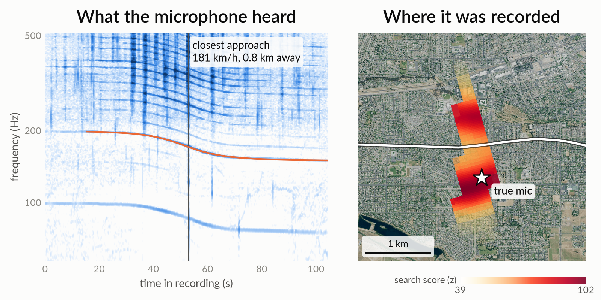

# dopplerprint



<sub>One real flyover, recording start known to ±10 s. One pass can't tell the two sides of the track apart;
more aircraft can. Best cell here: 307 m from the true microphone.</sub>

Work out where an audio recording was made from the aircraft in it. Each propeller or helicopter flyover
leaves a Doppler-shifted tone in the spectrogram; dopplerprint matches those curves against historical
ADS-B trajectories and searches the ground for the point that would have heard every one of them, at the
right time and pitch, and heard nothing that it didn't.

**Status: pre-alpha research code.** The pipeline runs end to end through the evaluation harness; there is
no stable user-facing `locate` command or API yet. Accuracy figures live in `runs/` reports, not here.

## Responsible use

This tool can place a recording, and therefore the person who made it, on a map. Use it on your own
recordings, on material published for this purpose, or with the recordist's consent. Don't use it to find,
track or expose people. Background and the limits of the method: `docs/research/prior_art_validation.md`.

## How it works

1. **Audio.** Decode, whiten and map to a log-frequency spectrogram; find ridges and fit a constant-velocity
   Doppler curve to each (rest frequency, speed, closest-approach range and time).
2. **ADS-B.** Stream adsb.lol daily archives into a Parquet track store; load prop and helicopter tracks
   (jets are flagged, not dropped) for the time and region prior.
3. **Search.** Coarse-to-fine over an EPSG:5070 lattice: associate events with flights, penalise cells that
   should have heard extra aircraft, score all events jointly with one shared clock offset, then refine.
4. **Output.** GeoPackage (with QGIS styles), GeoJSON and a single-file HTML viewer.

Details: `docs/ARCHITECTURE.md`, `docs/PHYSICS.md`, `docs/AUDIO.md`, `docs/DATA.md`, `docs/GEO.md`.

## Layout

| Path | Contents |
|---|---|
| `crates/dp-core` | All computation (Rust). |
| `crates/dp-cli` | `doppler-print` binary: `ingest`, `tracks`, `discover`, `sim`, `eval`. |
| `crates/dp-py` | `dopplerprint._core` Python bindings (PyO3, abi3, numpy). |
| `python/dopplerprint` | Offline prep (DEM, geoid) and the QGIS Processing plugin. |
| `tools/` | Dev runner, corpus fetch, benchmarks. |
| `experiments/` | One TOML per hypothesis, passed to `eval`. |
| `docs/research/` | Literature and design research behind the choices above. |

## Quick start

Needs Rust ≥ 1.90 and, for the Python package, Python ≥ 3.11 with [uv](https://docs.astral.sh/uv/).

```bash
tools/dev.sh check                 # clippy, whole workspace
tools/dev.sh test [filter]         # dp-core tests (cargo-nextest)
uv venv && tools/dev.sh py         # build dopplerprint into .venv
cargo run --release -p dp-cli -- discover recording.wav --out events.json
```

Real-world evaluation needs the validation corpus (recordings, ADS-B days, DEM), which is not in the repo:
see `data/MANIFEST.md` and `tools/fetch_corpus.py`, then `tools/dev.sh eval [experiments/x.toml]`.

From PyPI: `pip install dopplerprint`.

## Data and credits

- Method: colsto's video *"This background sound leaks your exact location"*; summary in
  `docs/research/transcript/analysis.md`.
- [DOPPLERGEIST](https://github.com/1337isnot1337/DOPPLERGEIST) (MIT, Cinna Davis): independent
  implementation used as the parity baseline.
- [thunderprint](https://github.com/Hexay/thunderprint) (MIT): project structure and GeoPackage output.
- ADS-B: [adsb.lol](https://adsb.lol) `globe_history`, © adsb.lol contributors,
  [ODbL 1.0](https://opendatacommons.org/licenses/odbl/1-0/). Test fixtures under
  `crates/dp-core/tests/fixtures/adsb/` and any track store you build from adsb.lol data remain under ODbL.
- Aircraft types and registry: [tar1090-db](https://github.com/wiedehopf/tar1090-db).
- Geoid: NGA EGM2008 (public domain), via [PROJ-data](https://cdn.proj.org/) `us_nga_egm08_25.tif`;
  the CONUS crop in `assets/geoid/` is derived from it.
- Header figure (`tools/readme_figure.py`, case `livermore_N9658K_R24`): audio from Praveen Pathak, Zenodo
  record 23424278 (CC BY 4.0); aircraft track © adsb.lol contributors (ODbL 1.0); imagery: USGS The National
  Map / NAIP, public domain (USGS 3DEP hillshade if the imagery can't be fetched).
- DEM, fetched by `python/dopplerprint/prep/dem.py`: USGS 3DEP 1″ (public domain), with Copernicus GLO-30 as
  fallback (© DLR e.V. 2010–2014 and © Airbus Defence and Space GmbH 2014–2018, provided under COPERNICUS by
  the European Union and ESA; all rights reserved).

## Licence

MIT, see `LICENSE`. Data sources keep their own licences (above). Contributing: `CONTRIBUTING.md`.
